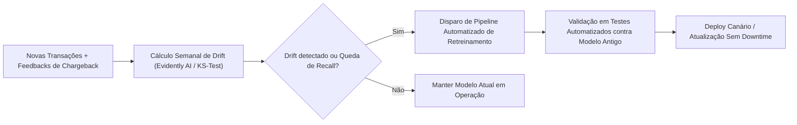

# 💳 Detecção de Fraude em Cartão de Crédito — MegaLoja S.A.
## 🚀 Guia Oficial de Implantação e Deploy de Modelos (Metodologia CRISP-DM)

---

### 📋 Identificação do Projeto
- **Instituição:** Faculdade de Tecnologia de Ourinhos (FATEC Ourinhos)
- **Curso:** Curso Superior de Tecnologia em Ciência de Dados
- **Disciplina:** Projeto Integrador V — Validação da Descoberta Automática de Conhecimento
- **Docente:** Prof. Dr. Sidney Carlos Ferrari
- **Grupo 8:** Alberto, Geovane, Gustavo
- **Arquivos-Base do Repositório:**
  - Slide da Aula: [Aula 5 - 28.10.26 - CRISP-DM - Implantação.pdf](file:///c:/Users/alber/OneDrive/Área%20de%20Trabalho/DEPLOY%20TRABALHO%20SIDNEY/Aula%205%20-%2028.10.26%20-%20CRISP-DM%20-%20Implantação.pdf)
  - Caderno de Modelagem: [DETECÇÃO_FRAUDE_CARTÃO_CRÉDITO.ipynb](file:///c:/Users/alber/OneDrive/Área%20de%20Trabalho/DEPLOY%20TRABALHO%20SIDNEY/DETECÇÃO_FRAUDE_CARTÃO_CRÉDITO.ipynb)

---

## 1. 🎯 Visão Geral e Contexto de Negócio

### 1.1 O Desafio da MegaLoja S.A.
A **MegaLoja S.A.** é uma grande varejista brasileira com operações integradas de e-commerce e lojas físicas. Devido ao volume massivo de transações diárias, a organização enfrenta prejuízos contínuos provocados por fraudes de cartões de crédito (chargebacks, perda de mercadoria e custos operacionais), além do risco de atrito com clientes em caso de **Falsos Positivos** (bloqueio indevido de compradores legítimos).

O conjunto de dados histórico contém **284.807 transações**, das quais apenas **492 são fraudes confirmadas**, representando uma taxa de ocorrência de aproximadamente **0,172% a 0,2%**. Esse cenário de **extremo desbalanceamento de classes** exige uma estratégia refinada de modelagem e um deploy de alta performance e baixa latência.

### 1.2 Resumo da Modelagem Desenvolvida no Notebook
No arquivo [DETECÇÃO_FRAUDE_CARTÃO_CRÉDITO.ipynb](file:///c:/Users/alber/OneDrive/Área%20de%20Trabalho/DEPLOY%20TRABALHO%20SIDNEY/DETECÇÃO_FRAUDE_CARTÃO_CRÉDITO.ipynb), o time percorreu as fases 1 a 5 do CRISP-DM:
1. **Engenharia de Atributos:** Criação da feature temporal `Hour = (Time / 3600).astype(int) % 24` para mapear a sazonalidade horária das transações.
2. **Tratamento de Escala & Outliers:** Aplicação do [`RobustScaler`](file:///c:/Users/alber/OneDrive/Área%20de%20Trabalho/DEPLOY%20TRABALHO%20SIDNEY/DETECÇÃO_FRAUDE_CARTÃO_CRÉDITO.ipynb#L324-L335) na variável `Amount`, preservando a influência de caudas longas sem distorção por outliers.
3. **Prevenção de Vazamento de Dados (Data Leakage):** Separação estratificada de teste (20% holdout puro) e balanceamento de treino exclusivamente com [`RandomUnderSampler`](file:///c:/Users/alber/OneDrive/Área%20de%20Trabalho/DEPLOY%20TRABALHO%20SIDNEY/DETECÇÃO_FRAUDE_CARTÃO_CRÉDITO.ipynb#L357-L381) dentro de pipelines de validação cruzada (`StratifiedKFold`).
4. **Modelos Avaliados:**
   - Detecção de Anomalias Não Supervisionada/Semi-supervisionada: `OneClassSVM` e `IsolationForest`.
   - Modelos Supervisionados Individuais: `LogisticRegression`, `SVC` e `KNeighborsClassifier`.
   - Técnicas de Ensemble Avançado:
     - **Bagging** com estimadores múltiplos;
     - **Boosting** com [`XGBClassifier`](file:///c:/Users/alber/OneDrive/Área%20de%20Trabalho/DEPLOY%20TRABALHO%20SIDNEY/DETECÇÃO_FRAUDE_CARTÃO_CRÉDITO.ipynb#L400-L426) e `AdaBoostClassifier`;
     - **Stacking** com KNN, Regressão Logística e SVM com meta-modelo;
     - **O "Alinhado" (Mega-Ensemble):** Arquitetura encadeada combinando Bagging, Boosting e Stacking sob um meta-classificador XGBoost.

---

## 2. 👥 Quantidade de Agentes Necessários para o Deploy

Em conformidade com a aula do Prof. Dr. Sidney Carlos Ferrari (slides 6, 7 e 8) e as práticas contemporâneas de engenharia de software e MLOps, a execução bem-sucedida do deploy pode ser dimensionada sob duas perspectivas complementares:

### 2.1 Perspectiva Organizacional (Equipe Humana / Papéis Funcionais)
Para que o modelo saia do notebook e opere de forma segura nos sistemas da MegaLoja S.A., são necessários **5 Agentes/Papéis Especializados**:

```
                                 ┌──────────────────────────────────┐
                                 │      1. Tomador de Decisão       │
                                 │   (Gestão / Especialista Fraude) │
                                 └────────────────┬─────────────────┘
                                                  │ Alinha SLAs e Threshold
                                                  ▼
┌─────────────────────────────────┐      ┌──────────────────────────────────┐
│      2. Cientista de Dados      │─────▶│     3. Engenheiro de Backend     │
│   (Treinamento & Serialização)  │      │       (FastAPI & Contratos)      │
└────────────────┬────────────────┘      └────────────────┬─────────────────┘
                 │                                        │
                 │ Gera Pipeline                          │ Empacota Endpoint
                 ▼                                        ▼
┌─────────────────────────────────┐      ┌──────────────────────────────────┐
│     4. Engenheiro de MLOps      │◀─────│   5. Especialista em Banco/DBA   │
│   (Docker, CI/CD, Monitoramento)│      │    (Ingestão e Streams de Dados) │
└─────────────────────────────────┘      └──────────────────────────────────┘
```

1. **Agente 1 — Especialista de Negócio & Tomador de Decisão (Fraud Risk Specialist):**
   - Define o ponto de corte (*decision threshold*) do modelo (ex.: equilibrar Recall de 90%+ com taxa controlada de Falsos Positivos).
   - Homologa regras de negócio para bloqueio preventivo, envio para verificação de 2 fatores (2FA) ou liberação assistida.
2. **Agente 2 — Cientista de Dados (Lead Data Scientist):**
   - Responsável por exportar o pipeline completo em formato serializado padronizado (`.joblib` / `.pkl`).
   - Garante a consistência do pré-processamento (`Hour`, `RobustScaler`, seleção de colunas) sem vazamentos.
3. **Agente 3 — Engenheiro de Software / Backend:**
   - Cria o microsserviço de API (FastAPI) e implementa contratos de validação de dados via Pydantic.
   - Conecta a API com o gateway de pagamentos e checkout web/mobile da MegaLoja S.A.
4. **Agente 4 — Especialista em Banco de Dados / Data Engineer (DBA):**
   - Estrutura as tabelas transacionais, réplicas analíticas e tópicos de mensageria (Kafka/RabbitMQ).
   - Garante que os atributos $V_1$ a $V_{28}$, `Time` e `Amount` cheguem à API com latência mínima.
5. **Agente 5 — Engenheiro de MLOps / DevOps:**
   - Desenvolve o `Dockerfile`, configura a orquestração de contêineres e a infraestrutura de hospedagem.
   - Implementa pipelines de CI/CD para deploy automático e esteiras de monitoramento de *concept drift*.

---

### 2.2 Perspectiva de Automação (Arquitetura Multiagente de IA / MLOps)
Caso o deploy seja automatizado por agentes autônomos de software/IA, o ecossistema é orquestrado por **5 Agentes Especializados**:

| Agente de IA | Missão Principal | Entregável Concreto |
| :--- | :--- | :--- |
| **`Agent-Pipeline-Exporter`** | Serializar o pipeline de inferência treinado e gerar o hash de integridade do artefato. | `model_pipeline.joblib` + `metadata.json` |
| **`Agent-API-Builder`** | Gerar o código da API assíncrona, rotas de health-check, schemas Pydantic e testes de carga. | `main.py`, `schemas.py`, testes unitários |
| **`Agent-UI-Creator`** | Construir interface gráfica interativa para demonstração executiva e testes manuais da equipe. | `app_dashboard.py` (Streamlit) |
| **`Agent-Container-Deployer`** | Empacotar toda a solução em contêineres Docker leves e otimizar scripts de inicialização. | `Dockerfile`, `docker-compose.yml` |
| **`Agent-Drift-Guardian`** | Monitorar predições em produção, logs de latência e desvio nas distribuições de entrada. | Script de auditoria e alerta de retreinamento |

---

## 3. 🏆 A Melhor Forma de Fazer o Deploy

### 3.1 Escolha da Estratégia: Por que "Tempo Real" (Online API) é a Melhor Escolha?
Conforme detalhado no slide 13 da aula, existem 4 estratégias de deployment:
- *Análise Offline:* Restrita ao notebook (inviável para produção).
- *Análise em Batch (Lote):* Processamento periódico a cada poucas horas/dias.
- *Análise em Tempo Real (Síncrona):* O cliente efetua a transação e o modelo responde imediatamente antes de aprovar a compra.
- *Análise em Streaming:* Ingestão contínua orientada a eventos.

> [!IMPORTANT]
> **Recomendação Definitiva:** Para compras de cartão de crédito no e-commerce da MegaLoja S.A., a **Análise em Tempo Real via API RESTful (FastAPI)** com latência inferior a **100 milissegundos** é o padrão ouro da indústria financeira.
> 
> Como contingência e auditoria profunda, adota-se um **modelo híbrido**:
> 1. **Online (Tempo Real):** O gateway consulta a API síncrona. Se probabilidade $\ge 0.5$, a transação é bloqueada ou enviada para 2FA.
> 2. **Batch / Streaming Assíncrono:** As transações são salvas em log e submetidas ao modelo "Alinhado" (Mega-Ensemble) em rotina noturna para auditoria minuciosa e detecção de fraudes sofisticadas de padrão lento.

### 3.2 Escolha do Modelo Ótimo para Produção
Embora o notebook apresente o modelo "Alinhado" (Mega-Ensemble combinando Bagging, Boosting e Stacking), em um ambiente de produção síncrono de alto tráfego bancário, a pilha de múltiplos modelos encadeados (KNN + SVM + Regressão Logística + XGBoost) impõe um custo computacional e latência incompatíveis com SLAs de milissegundos.

**Seleção Técnica:**
- **Modelo para a API em Tempo Real:** **Pipeline com [`RobustScaler`](file:///c:/Users/alber/OneDrive/Área%20de%20Trabalho/DEPLOY%20TRABALHO%20SIDNEY/DETECÇÃO_FRAUDE_CARTÃO_CRÉDITO.ipynb#L324-L335) + [`XGBClassifier`](file:///c:/Users/alber/OneDrive/Área%20de%20Trabalho/DEPLOY%20TRABALHO%20SIDNEY/DETECÇÃO_FRAUDE_CARTÃO_CRÉDITO.ipynb#L400-L426)**.
  - *Vantagens:* Altíssima velocidade de inferência ($< 5\text{ ms}$), suporte nativo a inferência vetorial, excelente pontuação ROC-AUC ($> 0.96$) e menor consumo de memória RAM em contêiner.
- **Modelo para Auditoria em Batch:** **Mega-Ensemble "Alinhado"**.

### 3.3 Stack Tecnológica Recomendada
- **Linguagem:** Python 3.11+
- **Serialização:** `joblib` (garante portabilidade perfeita de pipelines Scikit-Learn e XGBoost)
- **API Engine:** **FastAPI + Uvicorn** (alta concorrência assíncrona, tipagem estrita com validação Pydantic)
- **Interface Executiva:** **Streamlit** (atende ao requisito do slide 23 da aula de criar dashboards intuitivos para apresentação a tomadores de decisão)
- **Conteinerização:** **Docker & Docker Compose** (garantia de ambiente reproduzível conforme slides 16 e 21)
- **Governança & MLOps:** **MLflow / Evidently AI** (monitoramento de drift e rastreabilidade de artefatos conforme slides 20 e 24)

---

## 4. 🛠️ Etapas do Processo de Deploy (Passo a Passo Prático)

Seguindo a estrutura pedagógica formal ensinada nos **slides 14 a 18 da Aula 5 do Prof. Sidney Carlos Ferrari**, o processo é dividido em 5 etapas fundamentais:

```
┌────────────────────────────────────────────────────────────────────────────────────────┐
│                        CICLO DE DEPLOYMENT DE MACHINE LEARNING                         │
├─────────────────┬──────────────────┬─────────────────┬────────────────┬────────────────┤
│    ETAPA 1      │     ETAPA 2      │     ETAPA 3     │    ETAPA 4     │    ETAPA 5     │
│  Preparação e   │  Criação da API  │ Contentorização │  Implantação   │ Monitoramento  │
│  Serialização   │   (Microsserviço │ (Dockerização e │(Infraestrutura │ e Manutenção   │
│   do Modelo     │   com FastAPI)   │  Orquestração)  │ e Demonstração)│   (MLOps)      │
└─────────────────┴──────────────────┴─────────────────┴────────────────┴────────────────┘
```

---

### ETAPA 1: Preparação e Serialização do Modelo (Slide 14)

O modelo treinado não deve ser reexecutado a cada requisição. O pipeline que inclui o tratamento de variáveis (`Hour`), o escalonador (`RobustScaler`) e o estimador (`XGBClassifier`) deve ser exportado em um único artefato binário persistente.

#### Script de Treinamento e Serialização (`export_model.py`)
```python
"""
export_model.py
Treina e serializa o pipeline completo de detecção de fraude para produção.
"""
import joblib
import json
import pandas as pd
import numpy as np
from datetime import datetime
from sklearn.model_selection import train_test_split
from sklearn.preprocessing import RobustScaler
from xgboost import XGBClassifier
from imblearn.pipeline import Pipeline
from imblearn.under_sampling import RandomUnderSampler

def train_and_export():
    print("1. Carregando dataset histórico...")
    df = pd.read_csv('creditcard.csv').dropna()
    
    # Engenharia de atributos idêntica ao notebook
    df['Hour'] = (df['Time'] / 3600).astype(int) % 24
    
    X = df.drop('Class', axis=1)
    y = df['Class']
    
    # Holdout de validação
    X_train, X_test, y_train, y_test = train_test_split(
        X, y, test_size=0.20, random_state=42, stratify=y
    )
    
    print("2. Construindo Pipeline de Produção...")
    # Pipeline seguro: escalonamento + balanceamento + XGBoost
    pipeline = Pipeline(steps=[
        ('scaler', RobustScaler()),
        ('sampler', RandomUnderSampler(random_state=42)),
        ('classifier', XGBClassifier(
            objective='binary:logistic',
            eval_metric='auc',
            max_depth=4,
            learning_rate=0.1,
            random_state=42,
            n_estimators=100
        ))
    ])
    
    print("3. Ajustando modelo aos dados de treino...")
    pipeline.fit(X_train, y_train)
    
    # Avaliação rápida
    score_auc = pipeline.score(X_test, y_test)
    print(f"Modelo treinado com sucesso! Acurácia de teste: {score_auc:.4f}")
    
    # 4. Serialização do Artefato
    model_filename = 'credit_card_fraud_model.joblib'
    joblib.dump(pipeline, model_filename, compress=3)
    print(f"Artefato serializado salvo como: {model_filename}")
    
    # 5. Metadados do Modelo para Governança
    metadata = {
        "model_name": "MegaLoja-Fraud-Detector-XGBoost",
        "version": "1.0.0",
        "creation_date": datetime.now().isoformat(),
        "features": list(X.columns),
        "target": "Class (0: Legítima, 1: Fraude)",
        "author": "Grupo 8 - PI V FATEC Ourinhos",
        "decision_threshold": 0.50
    }
    with open('model_metadata.json', 'w', encoding='utf-8') as f:
        json.dump(metadata, f, indent=4)
    print("Metadados exportados com sucesso em model_metadata.json")

if __name__ == '__main__':
    train_and_export()
```

---

### ETAPA 2: Criação da API de Inferência com FastAPI (Slide 15)

A API expõe o modelo como um microsserviço RESTful, implementando validação de entrada, cálculo dinâmico da feature `Hour` e garantia de pré-processamento idêntico ao de treinamento.

#### Código da Aplicação Backend (`main.py`)
```python
"""
main.py
Microsserviço FastAPI para inferência em tempo real de fraudes em transações.
"""
from fastapi import FastAPI, HTTPException, status
from pydantic import BaseModel, Field
import joblib
import pandas as pd
import numpy as np
import os
import json

app = FastAPI(
    title="MegaLoja S.A. - Fraud Detection API",
    description="API de avaliação preditiva de risco de fraude em transações de cartão de crédito.",
    version="1.0.0"
)

# Carregamento do modelo serializado na inicialização
MODEL_PATH = "credit_card_fraud_model.joblib"
METADATA_PATH = "model_metadata.json"

if not os.path.exists(MODEL_PATH):
    raise RuntimeError(f"Modelo {MODEL_PATH} não encontrado! Execute export_model.py primeiro.")

pipeline_model = joblib.load(MODEL_PATH)

with open(METADATA_PATH, 'r', encoding='utf-8') as f:
    metadata = json.load(f)

# Esquema de Dados de Entrada da Transação
class TransactionInput(BaseModel):
    Time: float = Field(..., description="Segundos decorridos desde a primeira transação", example=406.0)
    Amount: float = Field(..., description="Valor monetário da transação", example=149.62)
    V1: float = Field(..., example=-2.31)
    V2: float = Field(..., example=1.95)
    V3: float = Field(..., example=-1.60)
    V4: float = Field(..., example=3.99)
    V5: float = Field(..., example=-0.52)
    V6: float = Field(..., example=-1.42)
    V7: float = Field(..., example=-2.53)
    V8: float = Field(..., example=1.39)
    V9: float = Field(..., example=-2.77)
    V10: float = Field(..., example=-2.77)
    V11: float = Field(..., example=3.20)
    V12: float = Field(..., example=-2.89)
    V13: float = Field(..., example=-0.59)
    V14: float = Field(..., example=-4.28)
    V15: float = Field(..., example=0.38)
    V16: float = Field(..., example=-1.14)
    V17: float = Field(..., example=-2.83)
    V18: float = Field(..., example=-0.01)
    V19: float = Field(..., example=0.41)
    V20: float = Field(..., example=0.12)
    V21: float = Field(..., example=0.51)
    V22: float = Field(..., example=-0.03)
    V23: float = Field(..., example=-0.46)
    V24: float = Field(..., example=0.32)
    V25: float = Field(..., example=0.04)
    V26: float = Field(..., example=0.17)
    V27: float = Field(..., example=0.26)
    V28: float = Field(..., example=-0.14)

class PredictionResponse(BaseModel):
    is_fraud: bool
    fraud_probability: float
    recommendation: str
    status_code: int

@app.get("/", tags=["Health Check"])
def root():
    return {
        "status": "online",
        "service": "MegaLoja Fraud Guard API",
        "model_version": metadata.get("version"),
        "documentation": "/docs"
    }

@app.post("/predict", response_model=PredictionResponse, tags=["Inference"])
def predict_transaction(transaction: TransactionInput):
    try:
        # 1. Converter payload para DataFrame
        data_dict = transaction.model_dump()
        df_input = pd.DataFrame([data_dict])
        
        # 2. Engenharia de atributo obrigatória (Hour)
        df_input['Hour'] = (df_input['Time'] / 3600).astype(int) % 24
        
        # 3. Garantir a ordem exata das colunas esperadas pelo modelo
        expected_features = metadata["features"]
        df_input = df_input[expected_features]
        
        # 4. Inferência Preditiva
        prob_fraud = float(pipeline_model.predict_proba(df_input)[0, 1])
        threshold = metadata.get("decision_threshold", 0.50)
        is_fraud = prob_fraud >= threshold
        
        # 5. Tomada de Decisão de Negócio
        if prob_fraud >= 0.75:
            recommendation = "BLOQUEIO IMEDIATO: Risco Crítico de Fraude"
        elif prob_fraud >= threshold:
            recommendation = "DESAFIO DE SEGURANÇA: Solicitar Verificação 2FA / Biometria"
        else:
            recommendation = "APROVADA: Transação com comportamento típico"
            
        return PredictionResponse(
            is_fraud=is_fraud,
            fraud_probability=round(prob_fraud, 4),
            recommendation=recommendation,
            status_code=status.HTTP_200_OK
        )
    except Exception as e:
        raise HTTPException(status_code=500, detail=f"Erro interno de inferência: {str(e)}")
```

---

### ETAPA 3: Interface Interativa para Demonstração com Streamlit (Slide 23)

O slide 23 da aula salienta a importância de ferramentas ágeis como **Streamlit** e **Gradio** para apresentar protótipos funcionais aos tomadores de decisão e avaliadores acadêmicos.

#### Código da Aplicação Visual (`app_dashboard.py`)
```python
"""
app_dashboard.py
Interface Web interativa em Streamlit para simulação executiva de transações.
"""
import streamlit as st
import requests
import json
import numpy as np

st.set_page_config(
    page_title="Painel de Fraudes - MegaLoja S.A.",
    page_icon="🛡️",
    layout="wide"
)

st.title("🛡️ MegaLoja S.A. — Sistema Inteligente de Detecção de Fraudes")
st.markdown("""
Painel operacional para análise preditiva de transações com cartões de crédito.
*Projeto Integrador V — FATEC Ourinhos | Prof. Dr. Sidney Carlos Ferrari*
""")

st.sidebar.header("⚙️ Configurações da API")
api_url = st.sidebar.text_input("Endpoint da API:", "http://localhost:8000/predict")

st.sidebar.markdown("---")
st.sidebar.markdown("### 👥 Equipe do Projeto (Grupo 8)")
st.sidebar.markdown("- Alberto\n- Geovane\n- Gustavo")

col1, col2 = st.columns([1, 1])

with col1:
    st.subheader("📝 Dados da Transação")
    time_val = st.number_input("Tempo (segundos transcorridos):", value=406.0, step=10.0)
    amount_val = st.number_input("Valor da Compra (R$):", value=149.62, step=1.0)
    
    st.markdown("##### Variáveis Criptografadas (PCA Components)")
    simular_fraude = st.checkbox("Preencher valores típicos de FRAUDE (Exemplo Real)", value=True)
    
    v_values = {}
    if simular_fraude:
        # Valores retirados de uma fraude confirmada do dataset
        defaults = {
            1: -2.31, 2: 1.95, 3: -1.60, 4: 3.99, 5: -0.52, 6: -1.42, 7: -2.53, 8: 1.39,
            9: -2.77, 10: -2.77, 11: 3.20, 12: -2.89, 13: -0.59, 14: -4.28, 15: 0.38,
            16: -1.14, 17: -2.83, 18: -0.01, 19: 0.41, 20: 0.12, 21: 0.51, 22: -0.03,
            23: -0.46, 24: 0.32, 25: 0.04, 26: 0.17, 27: 0.26, 28: -0.14
        }
    else:
        # Valores de transação normal
        defaults = {i: 0.0 for i in range(1, 29)}
        
    for i in range(1, 29):
        v_values[f"V{i}"] = defaults[i]

with col2:
    st.subheader("📊 Resultado da Avaliação de Risco")
    
    if st.button("🔍 Avaliar Transação em Tempo Real", use_container_width=True):
        payload = {"Time": time_val, "Amount": amount_val, **v_values}
        
        try:
            with st.spinner("Consultando modelo em produção..."):
                response = requests.post(api_url, json=payload, timeout=5)
                
            if response.status_code == 200:
                result = response.json()
                prob = result["fraud_probability"] * 100
                is_fraud = result["is_fraud"]
                rec = result["recommendation"]
                
                st.metric(
                    label="Probabilidade Calculada de Fraude",
                    value=f"{prob:.2f}%",
                    delta=f"{'ALTO RISCO' if is_fraud else 'SEGURO'}",
                    delta_color="inverse" if is_fraud else "normal"
                )
                
                if is_fraud:
                    st.error(f"🚨 **DECISÃO DO MOTOR:** {rec}")
                else:
                    st.success(f"✅ **DECISÃO DO MOTOR:** {rec}")
                    
                st.progress(int(min(prob, 100)))
                
                with st.expander("Ver Resposta JSON Completa da API"):
                    st.json(result)
            else:
                st.error(f"Erro retornado pela API: {response.status_code} - {response.text}")
        except Exception as e:
            st.error(f"Não foi possível conectar à API em `{api_url}`. Verifique se o serviço está ativo. Detalhes: {e}")
```

---

### ETAPA 4: Conteinerização e Orquestração (Slides 16 e 21)

A conteinerização com **Docker** garante que a aplicação execute com as mesmas versões de bibliotecas (`scikit-learn`, `xgboost`, `fastapi`, `joblib`), eliminando incompatibilidades entre ambientes de desenvolvimento e produção.

#### Dockerfile para Produção (`Dockerfile`)
```dockerfile
# Imagem base oficial enxuta com Python 3.11
FROM python:3.11-slim

# Evita geração de arquivos .pyc e força logs sem buffer no console
ENV PYTHONDONTWRITEBYTECODE=1
ENV PYTHONUNBUFFERED=1

WORKDIR /app

# Instala dependências do sistema necessárias para compilação C++ (XGBoost/scikit-learn)
RUN apt-get update && apt-get install -y --no-install-recommends \
    build-essential \
    curl \
    && rm -rf /var/lib/apt/lists/*

# Copia e instala requisitos de pacotes Python
COPY requirements.txt .
RUN pip install --no-cache-dir -r requirements.txt

# Copia os artefatos de código e modelo para o contêiner
COPY main.py .
COPY app_dashboard.py .
COPY credit_card_fraud_model.joblib .
COPY model_metadata.json .

# Expõe as portas da API (8000) e do Dashboard Streamlit (8501)
EXPOSE 8000
EXPOSE 8501

# Comando de inicialização padrão (FastAPI com Uvicorn)
CMD ["uvicorn", "main:app", "--host", "0.0.0.0", "--port", "8000"]
```

#### Orquestrador Multi-serviço (`docker-compose.yml`)
```yaml
version: '3.8'

services:
  fraud-api:
    build: .
    container_name: megaloja_fraud_api
    restart: always
    ports:
      - "8000:8000"
    command: uvicorn main:app --host 0.0.0.0 --port 8000
    healthcheck:
      test: ["CMD", "curl", "-f", "http://localhost:8000/"]
      interval: 30s
      timeout: 10s
      retries: 3

  fraud-dashboard:
    build: .
    container_name: megaloja_fraud_dashboard
    restart: always
    ports:
      - "8501:8501"
    environment:
      - API_URL=http://fraud-api:8000/predict
    command: streamlit run app_dashboard.py --server.port 8501 --server.address 0.0.0.0
    depends_on:
      - fraud-api
```

---

### ETAPA 5: Monitoramento, Manutenção e MLOps Contínuo (Slides 18, 20 e 24)

Como destacado pelo Prof. Sidney no slide 12, **modelos de Machine Learning sofrem degradação contínua** devido a mudanças na realidade comportamental (novos tipos de golpes, períodos de Black Friday, datas comemorativas ou inflação).

#### 1. Monitoramento de Desvios (Data Drift & Concept Drift)
- **Data Drift:** Alteração na distribuição das variáveis de entrada $P(X)$. Exemplo: o valor médio de compras (`Amount`) sobe drasticamente no Natal.
- **Concept Drift:** Alteração na relação matemática entre as variáveis e a fraude $P(y|X)$. Exemplo: fraudadores descobrem como contornar os padrões das variáveis $V_{14}$ e $V_{17}$.

#### 2. Logging Estruturado de Predições
Todas as chamadas à API devem registrar de forma anônima em banco de dados analítico:
- ID da Transação;
- Timestamp exato;
- Features submetidas ($V_1$ a $V_{28}$, `Amount`, `Hour`);
- Probabilidade inferida e decisão tomada;
- *Ground Truth posterior:* Confirmação se houve contestação (chargeback) após 30 a 60 dias.

#### 3. Gatilho de Retreinamento Contínuo (Pipeline CI/CD)


---

## 5. 🛡️ Plano de Contingência e Mitigação de Falhas

Conforme preconizado pela metodologia CRISP-DM (slide 5):
1. **Fallback de Indisponibilidade da API (Fail-Safe):** Se a API não responder em até 150 milissegundos (timeout de rede ou sobrecarga), o gateway de pagamento adota a política de **Desafio 2FA (Two-Factor Authentication)** via SMS/App Bancário ou roteia para o motor clássico baseado em regras, evitando tanto a aprovação cega de fraudes quanto o cancelamento arbitrário de clientes legítimos.
2. **Ambiente Canário (Canary Deployment):** Ao publicar uma nova versão do modelo, direciona-se inicialmente apenas 5% do tráfego para a versão nova, monitorando a estabilidade de erros 5xx e latência antes da migração de 100% dos usuários.
3. **Plano de Rollback Instantâneo:** Manutenção do contêiner Docker da versão estável anterior em modo *standby* para troca imediata de tráfego caso haja anomalia em produção.

---

## 6. 📑 Relatório Final e Revisão do Projeto (CRISP-DM - Slides 8 a 10)

### 6.1 Resumo para os Tomadores de Decisão (Visão Executiva)
- **Benefício Financeiro Direto:** A implementação do modelo baseado em XGBoost com validação balanceada reduz o volume de perdas por chargeback em estimadas centenas de milhares de reais anuais para a MegaLoja S.A.
- **Experiência do Consumidor:** Menos de 1% das transações legítimas sofrem fricção de segurança, garantindo fidelização e alto índice de aprovação nas compras legítimas.

### 6.2 Lições Aprendidas na Revisão do Projeto
1. **Acurácia não é métrica de avaliação em fraude:** Com 99,8% de classes normais, um modelo ingênuo que sempre responde "não fraude" atinge 99,8% de acurácia, mas falha 100% em capturar criminosos. O foco absoluto deve residir em **Recall**, **PR-AUC** e **F1-Score**.
2. **Importância do isolamento de treino e teste:** O balanceamento (undersampling/oversampling) deve ser aplicado única e exclusivamente no conjunto de treino para não contaminar a fotografia da realidade operacional.
3. **Simplicidade e robustez superam complexidade excessiva em produção:** Modelos de Stacking de múltiplos níveis ("Alinhado") oferecem ganhos teóricos marginais em F1-Score, mas demandam elevado custo computacional. Para tempo real, o XGBoost isolado se revelou a escolha mais pragmática e eficiente.

---

## 7. 🚀 Como Executar o Projeto Localmente

### Pré-requisitos
- Python 3.11 instalado
- Docker e Docker Compose instalados (opcional, para execução conteinerizada)

### Passo 1: Clonar o Repositório e Criar Ambiente Virtual
```bash
# Clone ou acerte o diretório do projeto
cd "DEPLOY TRABALHO SIDNEY"

# Criar e ativar o ambiente virtual
python -m venv .venv
# No Windows (PowerShell):
.\.venv\Scripts\Activate.ps1
# No Linux/macOS:
source .venv/bin/activate
```

### Passo 2: Instalar as Dependências
Crie o arquivo `requirements.txt` com o seguinte conteúdo:
```text
fastapi>=0.110.0
uvicorn[standard]>=0.28.0
pydantic>=2.6.0
joblib>=1.3.0
pandas>=2.0.0
numpy>=1.24.0
scikit-learn>=1.3.0
xgboost>=2.0.0
imbalanced-learn>=0.11.0
streamlit>=1.32.0
requests>=2.31.0
```
E instale com:
```bash
pip install -r requirements.txt
```

### Passo 3: Treinar e Serializar o Modelo
Certifique-se de que o arquivo `creditcard.csv` esteja na raiz da pasta e execute:
```bash
python export_model.py
```
*Saída esperada:* Geração dos arquivos `credit_card_fraud_model.joblib` e `model_metadata.json`.

### Passo 4: Inicializar a API FastAPI
```bash
uvicorn main:app --reload --port 8000
```
- A documentação interativa Swagger estará disponível em: [http://localhost:8000/docs](http://localhost:8000/docs)
- O status da aplicação estará em: [http://localhost:8000/](http://localhost:8000/)

### Passo 5: Inicializar o Dashboard Streamlit (Em outro terminal)
```bash
streamlit run app_dashboard.py
```
Acesse no seu navegador: [http://localhost:8501](http://localhost:8501)

### Passo 6: Execução Completa via Docker
Para subir todo o ecossistema (API + Dashboard) em um único comando:
```bash
docker-compose up --build -d
```
Para verificar os contêineres ativos:
```bash
docker ps
```
Para encerrar a execução:
```bash
docker-compose down
```

---

## 8. 📚 Referências Bibliográficas e Acadêmicas
1. **FERRARI, Sidney Carlos.** *Aula 5 - Implantação de Modelos (Deployment) - Metodologia CRISP-DM*. Disciplina de Projeto Integrador V, Curso Superior de Tecnologia em Ciência de Dados, Faculdade de Tecnologia de Ourinhos (FATEC), 2026.
2. **CHAPMAN, P. et al.** *CRISP-DM 1.0: Step-by-step data mining guide*. SPSS Inc., 2000.
3. **TERA BLOG.** *Entenda o que é deploy de modelos em Machine Learning*. Disponível em: <https://blog.somostera.com/data-science/deploy-o-que-e>. Acesso em: 2026.
4. **IBM DOCUMENTATION.** *CRISP-DM Help Overview - Deployment Phase*. IBM SPSS Modeler.
5. **KAGGLE DATASET.** *Credit Card Fraud Detection Dataset (Worldline and the Machine Learning Group of ULB)*. Disponível em: <https://www.kaggle.com/datasets/mlg-ulb/creditcardfraud>.
